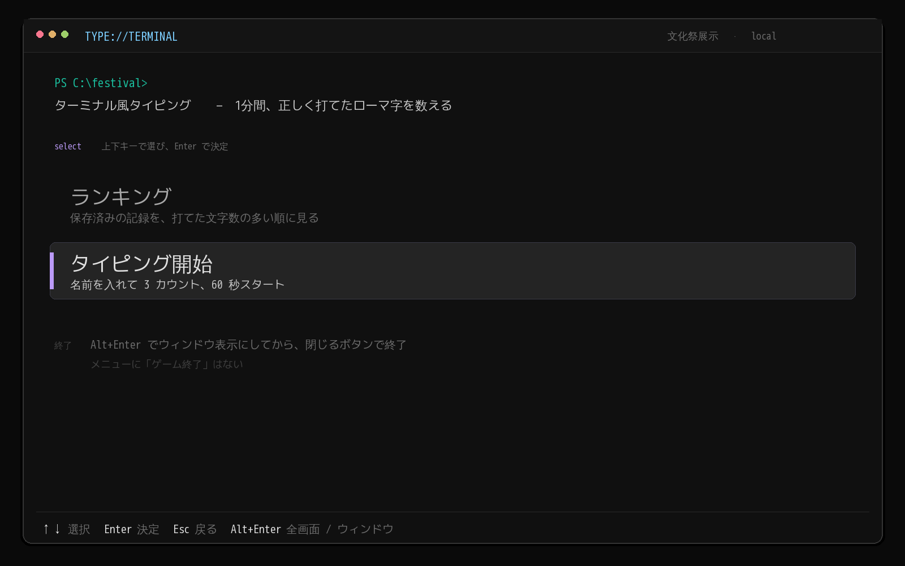
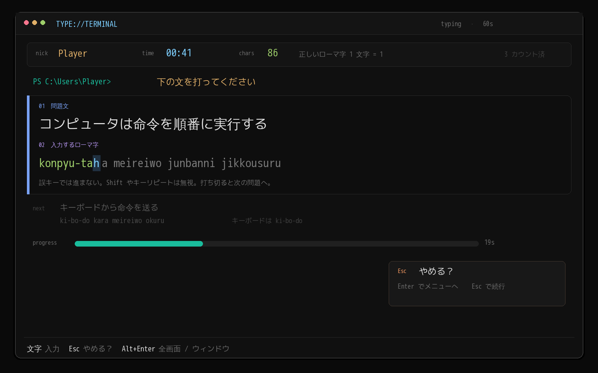
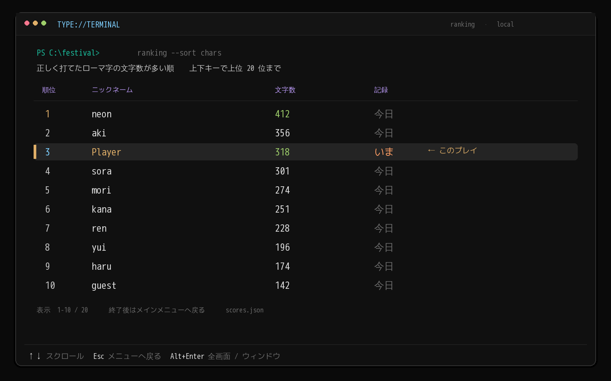

# コンセプト

コンソール画面風のタイピングゲーム！
文化祭での展示が目標
ローカルでのランキング機能で当日プレイした人とスコアで競おう！！

# 体験目標

ハッカーのイメージであるターミナル風の画面でゲームを遊んでもらい、コンピュータに触れる機会を作るともに、理解を深めてもらう。

# ループ

1.ゲームの起動

2.メインメニュー　選択肢（ランキング:タイピング開始）

3.ゲーム画面   

    ３ カウントで始める。
    タイピングゲームを始める前にニックネームを入力する画面を開く(デフォルトでPlayerが入力されている)
    Windowsのパワーシェルのような画面に問題文が２行で表示される。
    １行目では日本語でタイピングするべき問題文が、
    ２行目ではアルファベットで打つべき文字がローマ字で表示される。
    色合いはCLI版 Grokのデザインをもとにする。
    表示されている通りに文字が入力されると自動的に次の問題に移行する
    誤キーでは入力がすすまない(寿司打のようなイメージ)
    Shift など修飾キーとキーリピートは無視する。
    １分間タイピングを行う。
    画面に「下の文を打ってください」と出す。
    その間に何文字打つことが出来たかを計測。
    ng-words.txt で禁止語を管理する。
    scores.json に保存し、一時ファイルに書いてから置き換える。
    問題は problems.txt に 1 行 1 問で置き、当日差し替えられるようにする。
    出題順は固定にして、点数を公平にする。
    ローマ字はできる限り多くのパターンを対応させる
    長音は - キーで打つ
    プレイヤーネームと正しく打てたローマ字を１文字と判定し何個文字を打つことが出来たかをローカルに保存
    １ゲームが終了したらメインメニューへ戻る

4.ランキング画面

    今までに保存されていたプレイヤーデータを打つことができた文字数が多い順に並び替えて表示する。
    上下キー操作で上位２０位までさかのぼることが出来る。

5.ゲーム終了について
    Alt+Enterキーでボーダレスフルスクリーンとウィンドウ表示を切り替えることができる。
    ウィンドウ表示にしたのちウィンドウを閉じるボタンを押すことで終了できる

# 操作方法
    メニューなど
        上下キーで選択
        Enterキーで決定
        ESCキーで戻る

    タイピング中
        文字を打っていく
        ESCキーで終了しメインメニューへ戻る(やめる？と確認を行う)

# 未決
IMEを無視して入力を受け付ける方法

